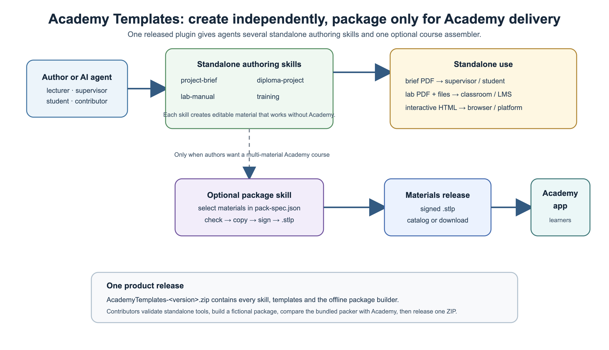
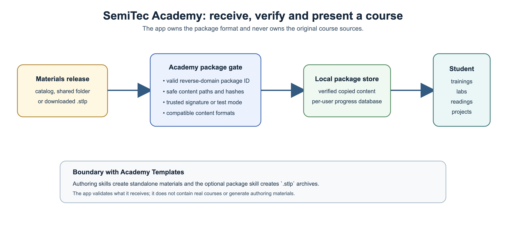

# SemiTec Academy

**SemiTec Academy** is the SemiTec Foundation's desktop learning app. Students install it once, create a
local account, and add **SemiTec Learning Packages** (`.stlp`) — one signed file per course with
trainings, labs, readings, videos and other materials. Progress is saved per student in a local database.
New packages and new versions of packages can be added at any time; the app does not need to change.

## SemiTec Foundation and source projects

SemiTec Academy is a SemiTec Foundation project. Visit [semitec.org](https://semitec.org) to follow the
Foundation's goals, aims and projects as its public site develops.

- [SemiTec Academy on GitHub](https://github.com/SemiTecFoundation/semitec-academy) — the desktop app,
  package format and local installers.
- [Academy Templates on GitHub](https://github.com/SemiTecFoundation/semitec-academy-skills) — the skills
  and templates used to create standalone learning materials or optional Academy packages.

© 2026 SemiTec Foundation. The source code is [Apache-2.0](LICENSE); SemiTec Foundation and SemiTec Academy
names, marks and logos are reserved as described in [TRADEMARKS.md](TRADEMARKS.md).

This repository contains the app, package-building tools and automated test fixtures. Course sources
and built course packages belong in `semitec-academy-materials`. No course package is distributed here.
The separate [Academy Templates](https://github.com/SemiTecFoundation/semitec-academy-skills) repository
contains the current AI-agent skills and templates for creating learning materials.





The [package lifecycle](docs/WORKFLOW.md) and [publishing workflow](docs/PUBLISHING.md) explain where each
part belongs. The app receives finished packages; it never owns or publishes course source material.

## Install

One file per system, no questions asked — details in [`docs/INSTALLING.md`](docs/INSTALLING.md):

Downloads: **[latest release](https://github.com/SemiTecFoundation/semitec-academy/releases/latest)**.

| System | Installer |
|---|---|
| Windows 10 / 11 | `SemiTec-Academy-Setup-<v>.exe` — one click: installs for the user, shortcuts, `.stlp` files, starts the app |
| macOS (Apple chip / Intel) | `SemiTec-Academy-<v>-mac-arm64.dmg` / `-x64.dmg` — drag to Applications, then **one Terminal line** to clear the quarantine mark (the build is not notarised): `xattr -dr com.apple.quarantine "/Applications/SemiTec Academy.app"` |
| Linux | `.AppImage` (run) or `.deb` (`sudo apt install ./…deb`) |

Building them: [`docs/RELEASING.md`](docs/RELEASING.md) — push a tag `v<version>` and the
[Build installers](../../actions/workflows/build-installers.yml) workflow builds all three on real
Windows, macOS and Linux machines and attaches them to the release. Locally:
`npm run dist:win|mac|linux`, or `app/tools/build-installers.sh` for this computer's system.

## What the student does

1. Installs **SemiTec Academy** and chooses a data folder (accounts, progress, packages live there).
2. Types a username: an existing user logs in with the password; a new username creates an account.
3. Starts on the **Dashboard**: numbers, *Continue learning*, the **Today** panel (what is due this week and
   what is overdue, for courses and projects), the next 14 days, latest certificates and news from the catalog.
4. Gets packages from the **Catalog** — folders (shared drive, OneDrive, USB) and catalog links published by
   the SemiTec Foundation or partner companies, set in *Settings → Application* — or adds a `.stlp` file
   (button, drag and drop, double-click). Every package shows its **publisher with logo** and cover; a
   publisher may also define accessible accent colours for its own package, labs, projects and materials.
5. Uses the **Library**: *My packages* (the student's own list, sorted into **groups** they create — a
   package can be in several groups) and *Explore* (every package installed on the computer, marked when it is
   already in My packages, enrolled or in progress). Both have search (also by group name / description),
   filters *All · In progress · Not started · Finished*, publisher, content type and sorting.
6. **Enrolls** in a course (start date; the author's week plan, a finish date, or self-paced) — the plan
   appears in the course's *Study plan* view and in the **Calendar**; a reminder shows when the app opens.
7. Opens the package. It is shown in **sections** — Trainings, Labs, Readings, Videos, Other materials
   (only those the package has) — or, if the author defined modules, in **course order**:
   - **trainings** — an interactive Academy JSON training (quizzes unlock topics and can issue a training certificate), or a self-contained local web training with its own JavaScript interactions;
   - **labs** — manual PDF (steps link to their page), steps checklist, **source files** (viewer,
     *Download all* as zip) and a check quiz; the lab header shrinks to one line while scrolling;
   - **readings** — PDF reader (outline, zoom, resume, pages read) or **Markdown reader** (outline,
     tables, code with *Copy*, images, text size, read tracking);
   - **videos** — player that resumes and tracks how much was watched, or a link to an online video;
   - **other materials** — PDF / image / code / Markdown viewers, *Save a copy*, *Open with default app*, links;
   - **projects** — advanced lab-style work: start a separate weekly plan, tick weeks, keep notes,
     follow milestones, deliverables, rubric, learning path and a brief PDF.
8. Collects **certificates**: one per completed standard JSON training, plus a course certificate only when the package
   publisher offers one; custom web trainings count toward that course certificate but make no individual one. View, print and save as PDF. **Projects** lists work from the student's *My
   packages* and separately tracks the plans they have started.

## Folder

```text
semitec-academy/
├── README.md                 this guide
├── LICENSE                   Apache-2.0 source license
├── NOTICE.md                 copyright and course-content boundary
├── TRADEMARKS.md             SemiTec name and logo use
├── docs/                     architecture, authoring, package format, install, release and workflow guides
│   └── diagrams/             PNG/SVG lifecycle diagrams used by the documentation
├── app/                      Electron application; version and dependencies in app/package.json
│   ├── src/
│   │   ├── main/             window, stl:// protocol, database, accounts and library
│   │   ├── preload/          the safe bridge (window.api)
│   │   ├── renderer/         student interface, library, calendar, projects, readers and authoring-flow image
│   │   ├── engine/training/  engine copied from the Skills repo's training skill
│   │   └── shared/           package format, versions and validation shared with the packer
│   ├── test/
│   │   ├── fixtures/         fictional packages and a throwaway key for tests only
│   │   ├── packages.test.js  package validation and safe-installation tests
│   │   └── e2e.js            Playwright + Electron desktop checks
│   ├── trusted-keys/         public keys whose signatures the app accepts
│   ├── build/                application and .stlp icons
│   └── tools/                engine sync and local installer build scripts
├── packer/stlp.js            CLI: check · create · inspect · keygen · bundle-skill
├── installers/<version>/     local build outputs; published installers are GitHub release assets
├── .github/workflows/        CI and cross-platform installer releases
└── keys/README.md            public key policy; see docs/KEYS.md
```

The AI skill that builds packages is part of the **Academy Templates** plugin
([`Academy Templates`](https://github.com/SemiTecFoundation/semitec-academy-skills/blob/main/README.md) in the Skills repository):
[`skills/package`](https://github.com/SemiTecFoundation/semitec-academy-skills/blob/main/skills/package/README.md)
(skill `academy-templates:package`, released as part of the Academy Templates product and compatibility-tested with the app).

The app is the learner-facing end of the workflow. Authors can use the other Academy Templates skills for
standalone labs, trainings and project briefs; the package skill is only needed to collect selected
materials into one Academy course. See [the package lifecycle](docs/WORKFLOW.md).

## Quick start (developer)

Requires **Node.js 20+**.

```bash
cd app
npm install                       # Electron, pdf.js, sql.js, fflate, marked, DOMPurify
npm start                         # run the app
npm test                          # package tests + desktop checks (Linux CI: xvfb-run -a npm test)
npm run test:unit                 # package tests without opening Electron
```

`npm test` needs no signing key and no second checkout: it builds its own fixture packages with a
throwaway key ([`app/test/fixtures/build.js`](app/test/fixtures/build.js)) and points the app at that
key, so nothing in this repository is signed with the production key.
The desktop suite uses a temporary profile and data folder and removes its test data after the run.
CI runs the package tests on Windows, macOS and Linux and the desktop checks on Linux for main-branch
updates and pull requests. Built `.stlp` files are ignored and rejected by CI; keep only fixture sources here.

To try a package in the app by hand, build it unsigned and switch on *Developer mode* in *Settings →
Application* (the app installs unsigned packages only then):

```bash
node packer/stlp.js check    <pack-spec.json>
node packer/stlp.js create   <pack-spec.json> --unsigned --out /tmp
#   → /tmp/<id>-<version>.stlp   (drag it onto the app window)
```

A release package is signed with its publisher's key. A recipient adds that publisher's public key in
*Settings → Application → Trusted publishers* after checking its fingerprint. See
[`docs/PUBLISHING.md`](docs/PUBLISHING.md) and [`docs/KEYS.md`](docs/KEYS.md).

`npm run sync-engine` is the one command that needs the
[skills repository](https://github.com/SemiTecFoundation/semitec-academy-skills) cloned next to this
one, so that `semitec-academy/` and `semitec-academy-skills/` share a parent folder.

## Make a package (author)

One **pack spec** lists all materials with their paths; `check` validates everything, `create` builds
and signs. Format: [`docs/PACK-SPEC.md`](docs/PACK-SPEC.md) · guide: [`docs/AUTHORING.md`](docs/AUTHORING.md).
With an AI assistant: the `academy-templates:package` skill writes the spec, runs the checker, fixes
what it can and creates the package.

## Versions

The **app version** (`app/package.json`) decides which **content formats** it can open
(`app/src/shared/versions.js`); the packer writes the formats used and the **minimum app version** into
every package; a package has its own **content version** for updates. See [`docs/VERSIONING.md`](docs/VERSIONING.md).

| App | Added |
|---|---|
| 1.0.0 | accounts, library, signed packages, trainings, labs, PDF readings |
| 1.1.0 | sections by type, videos, other materials, pack specs |
| 1.2.0 | lab source files, compact lab header |
| 1.3.0 | name **SemiTec Academy**, `.stlp` packages, Markdown readings and materials |
| 1.4.0 | installers; library search and filters; enrollment and study plans; calendar; Today panel and reminders; projects; certificates page |
| 1.5.0 | dashboard; catalog (folders + catalog links); publishers with logos; My packages / Explore with groups; materials attached to labs; project categories; settings *My account / Application / About* |
| 1.6.0 | prerequisites that are not counted in progress; course-order view; Markdown reading images; packer `catalog` command |
| 1.6.1 | new development signing key — the first one was published by mistake and is no longer trusted |
| 1.6.2 | production signing key `4c71eba82f86fcca`, the only trusted key; no development key is trusted any more; real contact details |
| 1.7.0 | locally trusted partner publisher keys; optional publisher feedback contact and package certificate; clearer independent project plans |
| 1.7.1 | projects follow each student's *My packages*; package removal stops active course and project plans after confirmation; stale plan references are cleaned on sign-in |
| 1.8.0 | optional publisher package branding: accessible accent colours for package details, labs, projects, readings and materials; trainings and certificates retain their own designs |
| 1.9.0 | self-contained local HTML/CSS/JavaScript trainings in a sandboxed frame, with a small progress bridge to Academy |

## License, package ownership and partner publishing

SemiTec Academy source and documentation are available under [Apache-2.0](LICENSE). Anyone may build and
share standalone materials or packages without a Foundation agreement or approval. The publisher remains
responsible for the course content, its rights, author attribution, feedback contact and any optional
certificate. A student or university chooses which publisher signing keys to trust locally. Read
[the publishing workflow](docs/PUBLISHING.md), [NOTICE.md](NOTICE.md) and [trademark guidance](TRADEMARKS.md).

## Status

Current release: **v1.8.0**. The next local build is **v1.9.0** with custom web-training support. All features are covered by `npm test`; installers for Windows, macOS and Linux
are built on real runners for each system and attached to every release.
Next: code signing (RELEASING.md), and the proposals in [`docs/PROPOSALS.md`](docs/PROPOSALS.md) — self-study features first; multi-user features belong to the Foundation platform.
