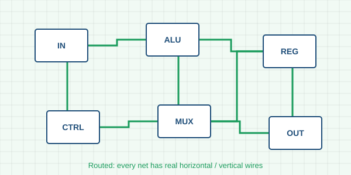

# Vivado quick reference for the labs

A one-page summary of the Vivado steps used in the FPGA Starter Track. Keep it open next to the lab.

> **Tip:** every step below is also a step in Lab 1 — tick it there when it is done.

## 1. The design flow

| Step | Vivado command | Result to check |
|---|---|---|
| Create project | *File → Project → New* (RTL project) | the board is selected |
| Simulate | *Flow Navigator → Run Simulation* | testbench prints `TEST PASSED` |
| Synthesise | *Run Synthesis* | no critical warnings |
| Implement | *Run Implementation* | **WNS ≥ 0** in the timing summary |
| Program | *Generate Bitstream → Open Hardware Manager* | the board shows the result |



## 2. Useful Tcl commands

Run them in the *Tcl Console* (or save them as a script):

```tcl
# reports after implementation
report_timing_summary -file timing.rpt
report_utilization    -file utilization.rpt

# program the first device found
open_hw_manager
connect_hw_server
open_hw_target
program_hw_devices [lindex [get_hw_devices] 0]
```

## 3. SystemVerilog reminders

- Use `always_ff` for flip-flops and `always_comb` for combinational logic.
- Non-blocking assignments (`<=`) in sequential blocks, blocking (`=`) in combinational ones.
- Synchronise every asynchronous input with **two flip-flops** before using it.

### State machines

A Moore machine: the output depends only on the state.


```systemverilog
typedef enum logic [1:0] {S0, S1, S2, S3} state_t;
state_t state, next;
always_ff @(posedge clk) state <= rst ? S0 : next;
```

## 4. When something goes wrong

1. **Timing fails** — look at the worst path in the timing report; add a pipeline register.
2. **Nothing on the LEDs** — check the pin names in the XDC against the board's master XDC.
3. **Simulation differs from hardware** — look for missing resets and latches (*Messages → Synthesis*).

---

*SemiTec Foundation · FPGA Starter Track · see also the [AMD documentation portal](https://docs.amd.com).*
